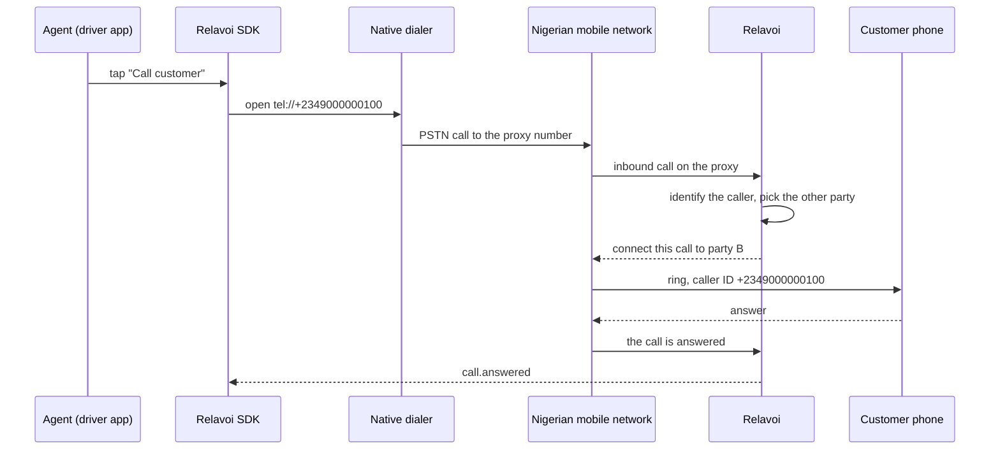

# Call flow and routing

This guide walks a masked voice call from the tap to the bridge, from the
outside: what each party does, and what your app can observe at each step.

## Primary call flow

The agent taps "Call customer" in your app. The SDK already knows the active
session and its proxy number. From there:

Three things in that sequence are worth holding on to.

**Neither phone ever learns the other's number.** The agent dials the proxy,
and the customer's handset shows the proxy as the caller ID. That is the whole
product, and it is why the proxy number is the only number either side sees.

**The customer needs no app.** The leg that reaches them is an ordinary call on
the Nigerian mobile network, so it rings on a feature phone exactly as it rings
on a smartphone, with no data connection.

**Your app is told, rather than having to ask.** Every state change arrives as
a webhook and on the event stream: `call.incoming`, `call.answered`,
`call.ended`, `call.failed`. See [Webhook
integration](./webhook-integration).

## Routing latency

Our routing target is **p99 under 500 ms**, measured from the moment the
network hands us the call to the moment we answer with where to connect it.
That window is the part of call setup we own; the rest of what a caller
experiences before the other phone rings belongs to the mobile network.

This is a target we hold ourselves to, not a measured average we are
publishing.

**Per-tenant routing latency is not exposed yet.** This page used to tell you
to alert on a `routing.latency.ms` metric in Analytics. No such metric exists.
Routing latency is measured, but only on our own side, and nothing returns it
per workspace, so that alert could never have fired. What
[Analytics](../api-reference/analytics) does give you is call volume, answer
rates, outcomes and durations. If a latency figure is something you need to
hold us to, ask us and we will expose one.

## When a call does not connect

A call that reaches a proxy with no live session for the caller is not dropped
in silence. The caller hears whichever behaviour your workspace is configured
for, and the attempt is still recorded against the session:

| `expiredCallBehavior` | What the caller hears |
|---|---|
| `DEAD_LINE` | A short message that the number is no longer in service |
| `REDIRECT_SUPPORT` | The call is connected to your support line |
| `PLAY_MESSAGE` | Your own recorded message |

Set it with `PATCH /v1/config`. See [Config](../api-reference/config).
